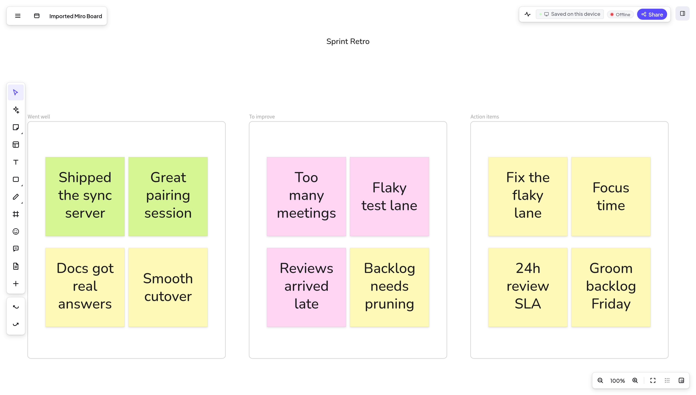

# Firo

**Workshop boards that remember.** Firo is an infinite-canvas workshop board with
structured records under the canvas - you can run a sticky-note session on the
board and see the same items as a table, a board, a grid, or a timeline. It is
free, open source (MIT), offline-first, and yours to self-host.

[](https://github.com/JavohirMX/firo/actions/workflows/lint.yml)
[](https://github.com/JavohirMX/firo/actions/workflows/test.yml)
[](https://github.com/JavohirMX/firo/blob/dev/LICENSE)



Most online whiteboards are great for the session and useless afterwards: sticky
notes are pixels, not data. The follow-up happens somewhere else. Firo keeps the
item and the placement in one model, so the board and the follow-up are two
views of the same thing.

The same model is shared by the canvas, the structured views, integrations and
AI agents - no sync layer to get out of date. Every edit is versioned and
reversible. AI and MCP tools are opt-in; the board, your data and the model
stay on your machine unless you say otherwise.

> **Status: early and moving fast.** The core is local-first: your boards open
> instantly and keep working offline. The sync server is available today,
> self-hosted in a single Docker container, with share links that support
> viewer/editor roles, optional passwords and expiry, and instant revocation.
> The public hosted app is planned. Things will change before 1.0, so expect to
> contribute (feedback counts as contributing).

## What makes it different

**Structured records under the canvas.** Every card on the board is a real item
with properties - status, assignee, size, tags, anything. See the same items as
a table, board, grid or timeline. Group them, filter them, sort them. Edit in
either place; both stay in sync. One model, many projections.

**Built for facilitators.** Voting, timer, presentation mode, private mode
(cards hidden until the reveal). A single facilitator key switches between
facilitate, present and edit modes, so participants can open the board on their
own devices without accounts or setup.

**Comments that land where they belong.** Comment threads on the board, not
just on shapes. Every comment is a first-class object that syncs and works with
mentions.

**Open source, end to end.** MIT licence. The web app, the sync server and the
AI integration ship in this repo. No phone-home, no paywall, no feature
editions.

## Importing from Miro

Firo imports Miro backups (`.rtb`) and Miro/Excalidraw JSON exports, so moving
an existing workshop over is a drag-and-drop away. Miro-only widgets that have
no Firo equivalent are called out in import warnings instead of disappearing
silently.

## Quickstart

Firo is a [Yarn 4](https://yarnpkg.com/) workspace monorepo.

```bash
# enable Yarn 4 via Corepack (Node 18+)
corepack enable

# install dependencies
yarn install

# build the packages
yarn build

# run the app in dev mode (web app + local sync server)
yarn dev
```

The web app runs at `http://localhost:3000`, the sync server at
`http://localhost:4000`. See [docs/localdev.md](docs/localdev.md) for the full
dev-loop guide (watch mode, hot reload, building the sync server).

## Self-hosting

The sync server ships as a single small Docker image. Data lives in one SQLite
file in a mounted volume. Create invite and share links from the UI, and share
them with viewer or editor roles, optional passwords and expiry.

```bash
docker run -d \
  --name firo-server \
  -p 8080:8080 \
  -v firo-data:/data \
  -e FIRO_PUBLIC_URL=https://boards.example.com \
  -e FIRO_BASE_DOMAIN=example.com \
  -e FIRO_INVITE_SECRET=$(openssl rand -base64 32) \
  ghcr.io/javohirmx/firo-server
```

[docs/hosting.md](docs/hosting.md) is the complete guide: building from source,
all configuration variables, running as a system service, backups and
restores, and verified nginx and Caddy reverse-proxy configs for putting it
behind TLS.

## AI and MCP

Firo has an opt-in AI layer: a local model runtime in the browser, a sidepanel
for board-aware chat, and an MCP server so external agents can read and edit
boards. Everything runs against the same local model. No data leaves your
machine unless you configure it to.

## Documentation

- [docs/localdev.md](docs/localdev.md) - local development loop
- [docs/architecture.md](docs/architecture.md) - how the canvas, model, sync
  and AI layers fit together
- [docs/hosting.md](docs/hosting.md) - self-hosting the sync server end to end
- [docs/schema.md](docs/schema.md) - the item model: shapes, views, properties
- [docs/datasync.md](docs/datasync.md) - sync, storage and the server API
- [docs/security.md](docs/security.md) - threat model, credentials, share
  links, reporting
- [docs/browser-support.md](docs/browser-support.md) - supported browsers and
  known engine quirks

## Contributing

Bugs, ideas and PRs are welcome. The codebase is TypeScript throughout. Run
`yarn typecheck`, `yarn lint` and `yarn test` before opening a PR. Bigger
changes (schema, sync protocol, AI behaviour) should start as an issue.

## Licence

MIT. Use it, fork it, host it, sell it - attribution is enough.
